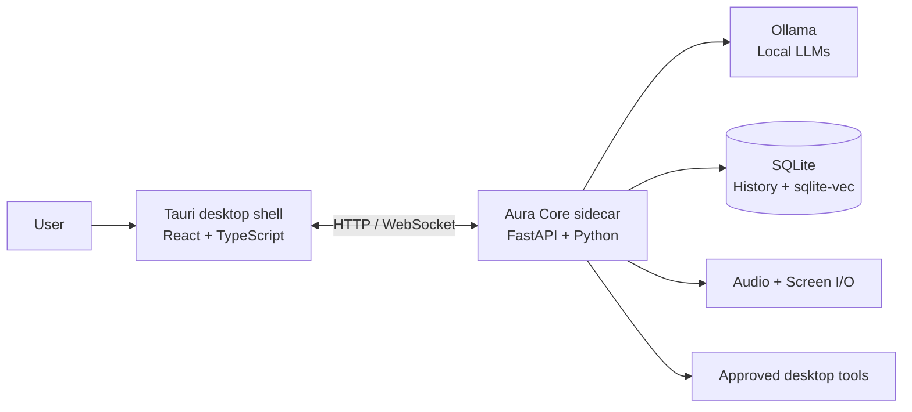

<div align="center">

# ✨ Aura

### Privacy-first, ambient AI desktop assistant

_A local-first AI layer for chat, voice, screen context, memory, and desktop tools._

[](https://tauri.app/)
[](ui/)
[](core/)
[](https://ollama.com/)
[](https://ollama.com/library)
[](https://sqlite.org/)

</div>

---

## Table of Contents

- [Overview](#overview)
- [Highlights](#highlights)
- [System Architecture](#system-architecture)
- [Technology Stack](#technology-stack)
- [Project Structure](#project-structure)
- [Getting Started](#getting-started)
- [Running the Application](#running-the-application)
- [CLI](#cli)
- [Local Models](#local-models)
- [Permissions and Safety](#permissions-and-safety)
- [Testing](#testing)
- [Building](#building)
- [Configuration](#configuration)
- [Roadmap](#roadmap)

---

## Overview

**Aura** is a cross-platform desktop AI assistant designed to keep application
data and model interactions local. The Tauri shell provides the native desktop
experience, while a Python FastAPI sidecar coordinates local models, audio and
screen input, retrieval, memory, and approved desktop tools.

The interface is centered around an always-available floating orb and a larger
Hub window for conversations, models, settings, and onboarding. The core also
exposes an OpenAI-compatible chat endpoint for the desktop client and CLI.

### Highlights

- **Local model runtime** — Ollama-backed chat and model management
- **Ambient desktop UI** — transparent, always-on-top orb plus a full Hub window
- **Multimodal input** — microphone, speech-to-text, text-to-speech, and screenshots
- **Retrieval-augmented memory** — document ingestion, embeddings, and SQLite vector search
- **Approved computer tools** — browser, clipboard, filesystem, notifications, shell, and desktop actions
- **Permission gates** — medium-risk actions require explicit approval by default
- **Cross-platform adapters** — platform-specific integrations for Linux, macOS, and Windows
- **Command-line access** — health checks, system recommendations, chat, and model operations

---

## System Architecture



### Runtime flow

1. Tauri starts the native shell and the Aura Core sidecar.
2. The React UI connects to the loopback-only FastAPI service.
3. Aura Core routes chat requests to the selected local Ollama model.
4. Memory, retrieval, I/O, and tools are invoked through dedicated core services.
5. Actions that need user consent are surfaced through the permission window.

---

## Technology Stack

| Layer | Technologies |
|---|---|
| Desktop shell | [Tauri 2](https://tauri.app/) · Rust |
| User interface | [React 18](https://react.dev/) · TypeScript · Vite |
| Styling and UX | Tailwind CSS · Lucide React · Zustand · React Markdown |
| Core API | Python 3.10+ · [FastAPI](https://fastapi.tiangolo.com/) · Uvicorn |
| Local inference | [Ollama](https://ollama.com/) |
| Audio and vision | faster-whisper · Kokoro ONNX · Piper TTS · Silero VAD · MSS |
| Retrieval | SQLite · sqlite-vec · pypdf · python-docx |
| Safety and integration | Pydantic · structlog · keyring · cryptography |
| Validation | pytest · pytest-asyncio · respx · Ruff |

---

## Project Structure

```text
.
├── core/                         # Python Aura Core sidecar
│   ├── aura/
│   │   ├── api/routes/           # Chat, health, models, RAG, tools, WebSocket
│   │   ├── io/                   # Audio, screen capture, STT, TTS, VAD
│   │   ├── memory/               # Conversation history
│   │   ├── ollama/               # Local model client and manager
│   │   ├── platform/             # Linux, macOS, and Windows adapters
│   │   ├── rag/                  # Ingestion, embeddings, retrieval
│   │   └── tools/                # Registry, approval, and built-in tools
│   ├── cli.py                    # `aura` command-line entry point
│   └── pyproject.toml
├── ui/                           # React frontend and Tauri application
│   ├── src/components/           # Orb, Hub, onboarding, permissions
│   ├── src/api/                  # Core API client and types
│   ├── src/stores/               # Chat, orb, settings, and tool state
│   └── src-tauri/                # Rust process, tray, IPC, and window setup
├── shared/config/defaults.toml   # Default runtime configuration
├── scripts/                      # Sidecar and Ollama packaging helpers
├── tests/                        # Cross-layer integration tests
└── uv.lock
```

---

## Getting Started

### Prerequisites

- Python 3.10 or newer
- [uv](https://docs.astral.sh/uv/)
- Node.js and npm
- Rust toolchain and Tauri prerequisites
- [Ollama](https://ollama.com/download) for local model inference

Install the Tauri prerequisites for your operating system by following the
[official Tauri setup guide](https://v2.tauri.app/start/prerequisites/).

### Install dependencies

```bash
uv sync
cd ui
npm install
cd ..
```

Start Ollama separately and make sure it is available on its configured port.
The default Aura configuration expects Ollama at `127.0.0.1:11435`.

### Run the core API

```bash
uv run --directory core python cli.py serve
```

The API binds to `127.0.0.1` by default. This is intentional: Aura is
designed to keep the local core off the network.

### Run the UI in development

```bash
cd ui
npm run tauri dev
```

---

## Running the Application

The Tauri application uses four windows:

| Window | Purpose |
|---|---|
| `orb` | Small transparent always-on-top assistant surface |
| `hub` | Main chat, model, and settings interface |
| `permission` | Approval dialog for gated actions |
| `onboarding` | First-run setup flow |

For frontend-only work, use Vite:

```bash
cd ui
npm run dev
```

---

## CLI

The Python package exposes an `aura` command:

```bash
uv run --directory core python cli.py health
uv run --directory core python cli.py system
uv run --directory core python cli.py chat "Summarize my notes"
uv run --directory core python cli.py chat "Explain this" --model gemma:2b --no-stream
uv run --directory core python cli.py models list
uv run --directory core python cli.py models pull gemma:2b
uv run --directory core python cli.py models delete gemma:2b
```

`aura system` reports available memory and recommends a model size. `aura
health` reports Aura Core, Ollama, the active model, and uptime.

---

## Local Models

Aura delegates inference to Ollama and does not require a hosted AI API key.
The default model is `gemma:2b`; models can be downloaded and selected through
the Hub or CLI.

```bash
ollama serve
uv run --directory core python cli.py models pull gemma:2b
uv run --directory core python cli.py chat "Hello, Aura"
```

Model files are stored under the configured Aura model directory. Model names
and hardware recommendations are configurable; use the model that fits the
machine's available memory.

---

## Permissions and Safety

Tool execution is registered through the core tool registry rather than being
run directly from the UI. Medium-risk operations require approval by default,
and system paths are restricted unless explicitly enabled. The core server
binds to loopback, and platform-specific operations are isolated behind
adapters.

Review tool permissions before enabling automation or changing
`allow_system_paths`. Treat shell, filesystem, browser, clipboard, and desktop
tools as privileged capabilities.

---

## Testing

Run the Python tests:

```bash
uv run pytest
```

Run the UI type-check and production build:

```bash
cd ui
npm run build
```

The test suite includes unit coverage for the Ollama client and integration
coverage for tool approval and multimodal I/O.

---

## Building

Build the Python core sidecar:

```bash
./scripts/build_core.sh
```

On Windows, use the PowerShell equivalent:

```powershell
.\scripts\build_core.ps1
```

The helper places the platform-named `aura-core` executable in
`ui/src-tauri/binaries/` for Tauri packaging.

To package the desktop application:

```bash
cd ui
npm run tauri build
```

The Ollama packaging helper can download bundled binaries for supported
platform targets:

```bash
./scripts/download_ollama.sh
```

---

## Configuration

Defaults live in [`shared/config/defaults.toml`](shared/config/defaults.toml):

| Setting | Default | Description |
|---|---|---|
| `core_port` | `11434` | Aura Core loopback port |
| `ollama_port` | `11435` | Ollama loopback port |
| `default_model` | `gemma:2b` | Initial chat model |
| `embed_model` | `nomic-embed-text` | Embedding model for retrieval |
| `ollama_models_dir` | `~/.aura/models` | Local model storage |
| `workspace_path` | `~/.aura/workspace` | Aura workspace |
| `require_approval_medium` | `true` | Gate medium-risk tools |
| `allow_system_paths` | `false` | Restrict filesystem scope |
| `auto_unload_minutes` | `5` | Model auto-unload interval |

Keep local configuration and model data out of version control.

---

## Roadmap

- Improve first-run hardware and model setup
- Expand platform-specific desktop integrations
- Add richer memory controls and retrieval diagnostics
- Improve packaging and release automation
- Add more user-configurable hotkeys and tool policies

---
## License

See [`LICENSE`](LICENSE) for the project license.
